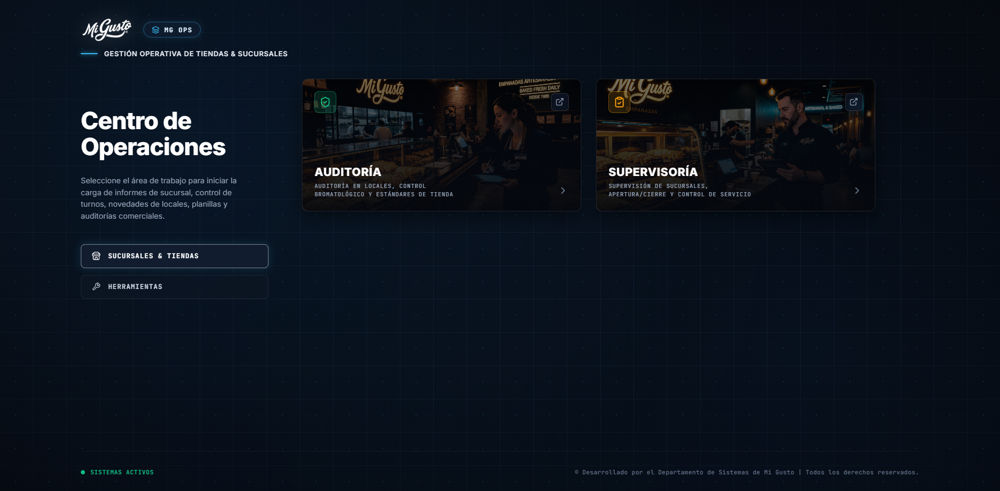
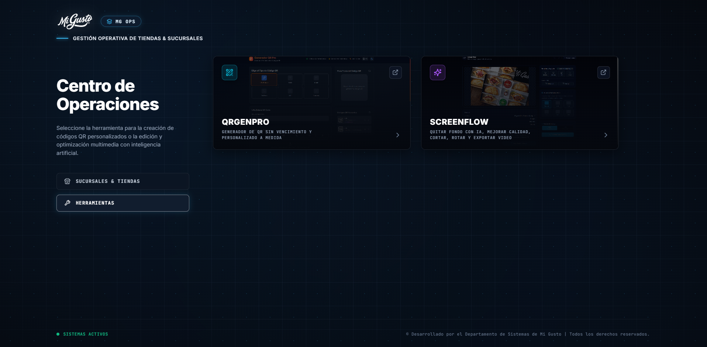

  

    

  # MG OPS • Centro de Operaciones
  ### Plataforma Centralizada de Gestión Operativa, Sucursales y Herramientas

  

    
    
    
    
    
  

  

    Portal unificado de alta fidelidad desarrollado para el <b>Área de Operaciones de Mi Gusto</b>. 
    Permite a supervisores, auditores y personal operativo acceder instantáneamente a los sistemas clave de control en tiendas y a la suite de utilidades digitales de la empresa.
  

---

## 📸 Galería del Portal

  <table>
    <tr>
      <td width="50%" align="center">
        <b>🏬 Sucursales & Tiendas</b> 
        Auditoría bromatológica y supervisión operativa en locales  
        
      </td>
      <td width="50%" align="center">
        <b>🛠️ Herramientas Digitales</b> 
        Generador QRgenPRO y Suite Multimedia ScreenFlow  
        
      </td>
    </tr>
  </table>

---

## 🌟 Módulos y Capacidades

### 🏬 Sucursales & Tiendas
Acceso unificado para el seguimiento y aseguramiento de calidad en toda la red de locales comerciales:

- **🛡️ Auditoría de Locales:** Control bromatológico, cumplimiento de estándares de manipulación de alimentos, temperaturas de horneado, presentación de producto en vitrinas y auditorías comerciales.
- **📋 Supervisoría de Sucursales:** Gestión de apertura y cierre, control de asistencia, turnos de personal, novedades de tienda y verificación de la calidad de servicio.

### 🛠️ Herramientas Operativas
Suite de utilidades para potenciar la productividad y comunicación en los puntos de venta:

- **📱 Generador de QR (QRgenPRO):** Generador profesional de códigos QR personalizados sin fecha de caducidad, diseñados a medida para cartas digitales, promociones de mostrador y enlaces de tienda.
- **✨ Editor de imagen y video (ScreenFlow):** Plataforma multimedia inteligente para optimización visual: eliminación de fondos con inteligencia artificial, mejora de resolución, rotación, corte y exportación ágil de contenidos para exhibición.

---

## ⚡ Experiencia de Usuario & Diseño

- **Fondo Tecnológico & Cyber-Grid:** Estética oscura inmersiva con cuadrícula técnica, efectos de iluminación sutiles (*glow*) por módulo y partículas.
- **Navegación Dinámica Fluida:** Cambio instantáneo entre vistas con animaciones optimizadas y retroalimentación sonora sutil mediante Web Audio API.
- **Atajos de Teclado Operativos:** Acceso ultra veloz a módulos y herramientas mediante teclas numéricas (`1` y `2`).
- **Diseño Adaptativo Premium:** Interfaz responsive optimizada tanto para estaciones de escritorio en oficinas centrales como para dispositivos móviles en tienda.
- **Open Graph Ready:** Metadatos y banners de vista previa optimizados para compartir enlaces enriquecidos en WhatsApp y canales de mensajería interna.

---

  © Desarrollado por el Departamento de Sistemas de Mi Gusto | Todos los derechos reservados.

